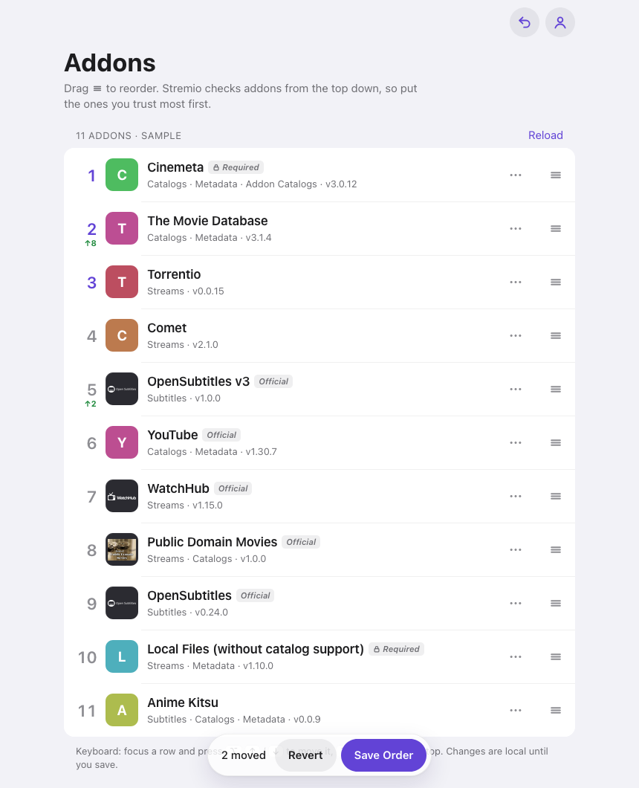

  

<h1 align="center">Stremio Addon Order</h1>

  Put your Stremio addons in the order you want, in your browser.

  
  
  
  

  <picture>
    <source media="(prefers-color-scheme: dark)" srcset="docs/screenshot-dark.png">
    
  </picture>

## Why the order matters

Stremio asks your addons for streams, subtitles and catalogs **from the top of the list down**. The addon you trust most should come first. The Stremio apps let you install and remove addons, but not reorder them, so this page does just that.

## Use it

1. Open **[hertn.github.io/stremio-addon-order](https://hertn.github.io/stremio-addon-order/)**.
2. Sign in with your Stremio account, or paste an auth key.
3. Drag addons into place, then press **Save Order**.
4. Restart Stremio on your devices to pick up the new order.

Want to look around first? The **[demo](https://hertn.github.io/stremio-addon-order/?demo)** uses sample addons and never saves anything.

## What you can do

| | |
| --- | --- |
| **Reorder** | Drag by the grip, with mouse or touch. On a keyboard, focus a row and press <kbd>⌥</kbd> <kbd>↑</kbd> / <kbd>↓</kbd>; add <kbd>⇧</kbd> to jump to the top or bottom. |
| **See what changed** | Small arrows mark only the addons you actually moved, not every row that shifted. |
| **Undo** | <kbd>⌘</kbd> <kbd>Z</kbd> steps back. **Revert** returns to the saved order. Nothing reaches Stremio until you save. |
| **Tidy up** | The ⋯ menu moves an addon to the top or bottom, copies or opens its manifest, or removes it. Stremio's required addons can't be removed. |
| **Back up** | Download your addon list as JSON before you change anything. |

Works on Mac, Windows, Linux, iPhone, iPad and Android, in light and dark mode.

## Privacy

- There is no server behind this page. It's one HTML file, and your browser talks **directly to Stremio** (`api.strem.io`).
- Your password goes to Stremio only. The page keeps the session key Stremio returns, in your browser's local storage, and Sign Out deletes it.
- No analytics, no tracking, no third-party scripts.

## Run it yourself

Download [`index.html`](index.html) and open it, or put it on any static host. There's nothing to build or install.

## Notes

This is an unofficial tool and isn't affiliated with Stremio. It uses the same API as the Stremio web app, which could change without notice.

> **100% vibe coded.** Every line was written by AI (Claude) from plain-language instructions. Expect rough edges, and keep a backup.

## License

[MIT](LICENSE)
